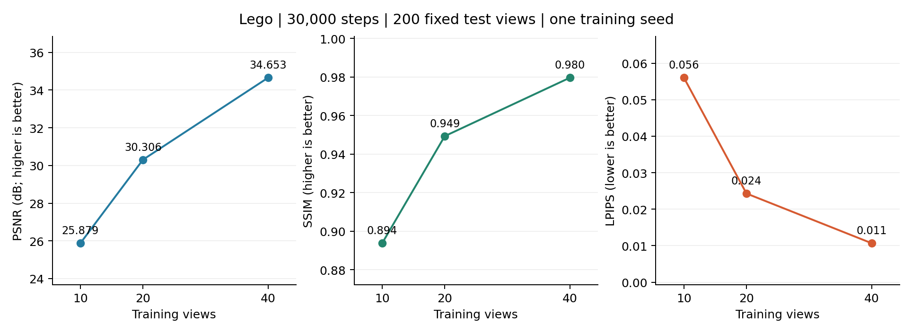
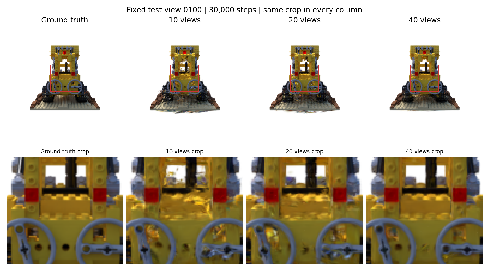

# 训练视角数量对 3D Gaussian Splatting 新视角合成质量的影响

配套仓库：https://github.com/wwwwwwcy/3dgs-view-count-study

深度学习课程设计。基于已有方法开展小规模实验研究，实际使用 **Nerfstudio Splatfacto 1.1.5 / gsplat 1.4.0**，不是原论文 INRIA 训练实现，也没有复现 FSGS 或提出新算法。

研究问题：在已知相机参数、相同初始化和固定训练步数下，10、20、40 个训练视角如何影响同一 Lego 场景的未见视角渲染？哪些细节更容易失真？

## 实际完成的实验

三组均从同一份 10000 点随机点云开始，400×400、30000 步、种子 42；训练全部完成后，在相同 200 张测试图上评估。

| 训练视角 | PSNR/dB ↑ | SSIM ↑ | LPIPS ↓ | PLY/MiB |
| --- | --- | --- | --- | --- |
| 10 | 25.8787 | 0.893821 | 0.056021 | 8.914 |
| 20 | 30.3059 | 0.949295 | 0.024294 | 9.243 |
| 40 | 34.6534 | 0.979561 | 0.010686 | 8.723 |





这是**单场景、单种子**结果，平均改善不代表每一张图都改善。40 相比 20 视角的 PSNR 在 191/200 张图上更高，9 张更低。20 视角训练的单调计时与系统起止跨度相差约 979.81 秒，原因未确定；同时保留两种计时，不据此作严格速度排序。

[完整指标与时间说明](records/experiments/20261027_134747_lego_main/summary.md) · [逐图结果](records/experiments/20261027_134747_lego_main/n010/test/per-view.csv) · [定性分析](records/experiments/20261027_134747_lego_main/qualitative-analysis.md) · [可编辑的 6 页 Word 报告](output/report/训练视角数量与3DGS新视角合成_课程报告.docx)

## 实验公平性与适用范围

- 数据：作者公开的 **NeRF Synthetic Lego**，原训练/验证/测试图数量为 100/100/200，原分辨率 800×800 RGBA；使用公开 Blender 相机内外参，不是自行拍摄的照片。
- 从 100 个候选训练相机的方向最远点遍历序列取前 10、20、40 项，构成嵌套子集；使用候选训练位姿，不利用测试误差挑选训练图。
- 测试图片不参与训练、调参或检查点选择，所有组用最终检查点。准确划分见 [lego-splits.json](records/data/lego-splits.json)。
- 三组共用与所有图像独立的随机初始化，不使用全量 SfM 点云。点云可用划分脚本重建，参数及哈希见 [initialization.json](records/data/initialization.json)。
- 固定白背景、分辨率、30000 步及主要配置，关闭相机优化与 torch.compile。固定步数不等于每张图片获得相同更新次数；自适应增密和裁剪会导致最终模型规模不同。
- **这是已知相机条件下的外观学习，不是仅输入少量照片的端到端位姿估计和重建。**

## 数据获取与复现

训练需 Linux 或 WSL2 和 NVIDIA CUDA 显卡。本次环境为 RTX 3070 Ti Laptop 8 GB、Ubuntu 22.04、Python 3.10.22、PyTorch 2.1.2+cu118、gsplat 1.4.0+pt21cu118。其他机器需先验证环境，不能直接将驱动显示的 CUDA 版本当作 PyTorch 的运行时版本。

脚本自动定位当前项目，不依赖原电脑盘符或用户名。默认 Conda 位于 `$HOME/miniconda3`；如安装位置不同，先设置：

```bash
export SPLAT_CONDA_EXE=/your/conda/bin/conda
# 可选：export SPLAT_ENV_DIR=/your/conda/envs/splat-course
# 可选：export SPLAT_UPSTREAM_DIR=$HOME/src/splat-course/nerfstudio
```

在仓库根目录依次执行：

```bash
sudo bash scripts/00_system_dependencies.sh
bash scripts/01_create_environment.sh
bash scripts/02_install_training.sh
bash scripts/03_download_data.sh
bash scripts/04_verify_and_prepare.sh
bash scripts/05_run_pilot.sh
bash scripts/06_run_experiments.sh
bash scripts/07_analyze_experiments.sh
```

03 从作者提供的 UC San Diego 地址下载公开归档，只提取 Lego；没有重新分发数据。04 会重新生成带当前绝对路径的划分文件和共同随机点云，移动仓库后应重新执行。05 是 1000 步、8 张独立验证图的流程试跑，不与正式测试结果混用。

06 会开始新的 10/20/40 正式实验，需要 GPU；它不会把归档中的旧运行当成新结果。07 对本机训练生成的全部渲染结果重新分析。原实验的模型、600 张渲染对照和完整数据仍留在实验电脑中，未上传。

不重训也可用标准库检查已发布的逐图指标与汇总：

```bash
python scripts/verify_published_results.py
# 仅重新画数值趋势，需要 matplotlib；不会训练或访问测试图像
python scripts/plot_results.py
```

上游 Nerfstudio 固定提交 `6b60855003011b2ca23c2fe3f8e2ca6314c69924`；安装脚本核对该提交。训练依赖约束在 `configs/constraints.txt`，原环境审计清单在 `records/setup/`。审计文件中的 `${ENV_DIR}` 等是历史路径的脱敏占位符，不用于直接安装或恢复训练。

重新生成 Word 另需 `requirements-report.txt` 中的依赖，然后运行 `python scripts/build_course_report.py`。报告署名按要求留空，首页已列出配套仓库地址。

## 文件与溯源

| 目录或文件 | 内容 |
| --- | --- |
| `scripts/` | 可配置路径的环境、数据、训练、评价和绘图入口 |
| `configs/` | 实验协议和依赖约束 |
| `records/data/` | 下载来源、数据划分、初始化与相机覆盖图 |
| `records/setup/` | 实际软件版本、评价权重来源与验证记录 |
| `records/experiments/20261027_134747_lego_main/` | 9 阶段日志、逐图指标、汇总和对照图 |
| `records/experiments/20261027_134747_lego_main/code/` | 本次实际执行的三份原始 Python 代码快照 |
| `publication-manifest.json` | 公开文件与原文件的哈希、脱敏说明 |
| `output/report/` | Word 报告及生成和版面核对记录 |
| `THIRD_PARTY.md`、`references/` | 上游来源、引用及 AI 使用说明 |

历史记录只脱敏了机器路径，不改动数值、退出码或时间异常；精确的原始记录保存在实验电脑。执行代码快照保持原字节，维护中的启动脚本已改成可配置路径。原记录内的哈希对应原始文件，公开副本的哈希另见 publication-manifest.json。

## 来源与 AI 辅助

原始 3DGS：[Kerbl 等的项目](https://repo-sam.inria.fr/fungraph/3d-gaussian-splatting/)。实际训练实现：[Nerfstudio Splatfacto](https://docs.nerf.studio/nerfology/methods/splat.html)，光栅化后端：[gsplat](https://github.com/nerfstudio-project/gsplat)。数据：[NeRF 作者仓库](https://github.com/bmild/nerf)。

项目新增工作是数据划分、共同初始化、实验调度、评价核对、指标汇总与分析。使用 OpenAI Codex 协助环境排错、脚本编写、结果整理和报告编辑。所有实验指标及对比图来自本机实际运行。上游算法、代码、数据和依赖按各自来源及许可证使用，详见 [THIRD_PARTY.md](THIRD_PARTY.md)；不将他人实现称为个人原创。
